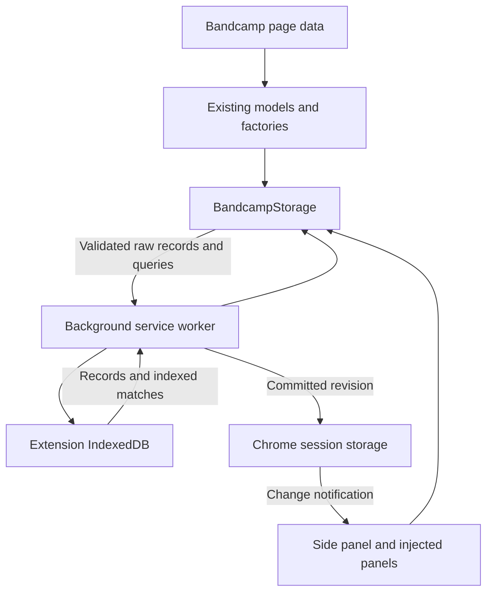

# Music data storage flows

## Music library

Bandcamp profiles, albums, tracks, and URL references are stored as plain raw
records in the extension-origin IndexedDB database `bcx-library`, version 1.
Chrome local storage retains settings, pinned navigation, and fan-library data.
Chrome session storage retains disposable tree snapshots and a small music-library
change notification. No existing local music data is imported or read as a fallback.

| Object store | Key | Indexes |
| --- | --- | --- |
| bands | id | nameKey (non-unique), savedOrder |
| albums | id | bandId, artistKeys (multi-entry), titleArtist (titleKey + artistCreditKey), savedOrder |
| tracks | id | albumId, savedOrder |
| urlRefs | URL UUID | entity (store + id) |
| meta | key | none |

Band IDs identify Bandcamp profiles, which can belong to labels. Album artist
credits remain independent of the hosting band. Normalized name keys support
lookups without merging identities. Albums retain ordered track IDs, while band
profiles retain ordered album and standalone track IDs. Records include savedAt
and stable savedOrder fields; updates preserve initial ordering. Artwork IDs and
URLs are retained, but image bytes and audio are not archived.

## Writing and reading

Content scripts, injected panels, and extension pages use the typed
`MUSIC_LIBRARY` message through `requestMusicLibrary`. The background worker
validates requests and owns all IndexedDB access. Database modules do not import
DOM-dependent page state. IndexedDB accessed directly from a content script would
belong to the host page, not the extension.

A save commits related profiles, albums, tracks, URL references, and the durable
library revision together in a readwrite transaction. Only successful transaction
completion is reported as a save. Missing or empty catalog-summary fields preserve
richer saved page metadata. Basic summaries do not replace detailed release data.
URLs are canonicalized before recording UUID references; earlier aliases can still
resolve the same entity. Track removal also removes its URL references.

Artist/title queries use database indexes rather than reading all saved albums.
The existing `BandcampStorage` factory-facing methods retain their compressed
return shapes through a small compatibility adapter; compression is not the
database storage format. The old `/bands` map is a derived compatibility view,
not another persisted index. Band lookups by name can return multiple profiles.

Every committed write records a revision in IndexedDB and publishes it at
`/music-library/revision` in Chrome session storage. Mounted previews invalidate
their query caches and reload saved details on changes. Band and music-dependent
fan subtree snapshots include the revision while retaining their keys, TTLs, and
serialization. Following Genres keeps its fan-data revision alone.
Connections close on version changes; blocked upgrades and storage failures
produce explicit errors. No permission removes database quota or eviction limits.

## Storage reporting

The Storage panel includes Music library in Current and History. Database store
counts are measured in one readonly transaction. Byte usage and quota use
`navigator.storage.estimate()` for the extension origin and are labeled as
estimates; per-store byte sizes are unavailable. Category size charts omit those
unknown sizes. Chrome local, session, and sync measurements remain separate.

## Fan library and unavailable entries

`src/bandcamp/domain/fanData/library.ts` keeps the original `/collection`,
`/wishlist`, `/following-bands`, and `/following-genres` array fields. Collection,
Wishlist, and Following Bands display these saved entries before the first sync,
without an import step. The array shape stays compatible with existing readers.
Account-scoped membership and saved history remain at `/fan-data/account/{fanId}`. Each dataset retains all previously seen records and a
separate ordered list of current IDs. Missing IDs are never deleted. Releases use
`a:{id}` or `t:{id}`, bands use `band:{id}`, and genre identities use their tag URL.
Successful snapshots merge fields; absent/null fields do not erase saved metadata.
Existing detailed `BandcampStorage` records remain intact.

`/fan-data/account/{fanId}/unavailable` is a separate registry of confirmed
unavailable references, with URLs, timestamps and reasons. The account's
`/availability` registry also records accessible and inconclusive checks. Only
HTTP 404/410 at the requested URL adds an Unavailable entry. Redirects, challenges,
unsupported custom domains and request failures remain inconclusive. An accessible
Bandcamp page removes an earlier Unavailable status. List membership is independent:
a missing item can still be accessible (for example, an unfollowed band).

Sync checks missing records and previously unavailable records in the selected
list. The Sync tab also offers a check of all saved release/band pages, including
items still in current lists. Oldest/unattempted checks run first so retries after
a timeout make progress. Results are saved incrementally. Genres retain historical
membership but do not receive page-availability classifications.

Collection, Wishlist, and Following Bands show all saved entries in their first
catalog tab. Their Unavailable tab appears before No longer listed. Following
Genres shows every saved genre in All and filters former follows in No longer
followed. Following badges use current membership, so a saved band missing from
the latest list is not shown as currently followed.
One top-level Sync tab manages all four fan datasets. It offers full or individual
list sync, saved-page availability checks, job progress, errors, and each list's
last sync time. While a job runs or needs attention, fan-data panels show a compact
status link back to Sync. Artist and release pages identify the signed-in fan
through `identities.fan.id` (with a `fan_id` fallback). Without a verified account,
the Sync controls remain visible but disabled with a sign-in message, and empty
archive tabs remain visible.

History keeps All, Bands, Releases, and Tracks subtabs. Search stays within the
selected type, and pagination remains in batches of 50.
After the Collection page verifies the account and returns a complete dataset,
sync validates the response and stages it at
`/fan-data/account/{fanId}/staging/{dataset}`. It merges the existing shared array
and account history by stable ID, then publishes the merged array, account metadata,
and ownership revision in one storage write. Fresh items come first; saved missing
entries remain afterward. Failed validation or publishing leaves prior saved data
intact; staging is removed after the attempt and is never read by the panels.

`/fan-data/saved-list-owners` records the fan ID and revision for each shared array.
Previously unassigned arrays are adopted during a verified sync. A list already
owned by another account is not adopted; that account retains its own saved copy.
When switching accounts, panels use the matching account history if the shared
array belongs to another fan. Ordinary sync now includes older data automatically;
the former explicit import action remains supported only for message compatibility.

`/fan-data/sync-job` stores job progress and errors. An interrupted worker marks the
job interrupted on its next startup; retry preserves already committed data.
The manifest does not request `unlimitedStorage`. Fan libraries and staging
snapshots remain subject to Chrome local storage's 10 MB quota; music data uses
the separate IndexedDB quota. Reload the extension after manifest changes.
Storage callbacks normalize Chrome's
plain `runtime.lastError` objects into JavaScript Errors, preserving their message.
Sync errors include the failing step and any datasets already published, and the
panel suppresses the initial saved-list notice while a failure is displayed.
Storage failures are reported as errors rather than successful syncs.
Saved artwork URLs are retained, but image bytes and audio are not archived.

Sync requests check the background worker's protocol version before starting a
job. Jobs carry that version so the UI can identify saved errors produced by an
older worker and explain that BCX must be reloaded in `chrome://extensions`,
followed by refreshing Bandcamp. Reloading only the web page does not update the
extension service worker.

Temporary sync tabs are created inactive in the originating tab's window and
excluded from side-panel configuration. Cleanup closes only a still-owned,
inactive temporary tab; it preserves activated tabs, navigated tabs, and the
originating tab. Background side-panel configuration ignores missing URLs and
unchanged enablement, avoiding redundant reconfiguration during background work.
Concurrent storage-read timings use elapsed timestamps rather than shared
console timer labels.
