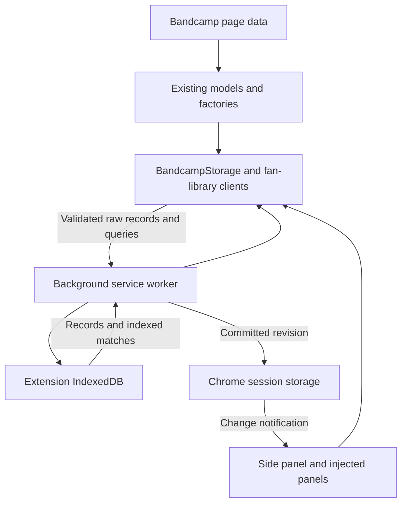

# Music data storage flows

## Music library

Bandcamp profiles, albums, tracks, and URL references are stored as plain raw
records in the extension-origin IndexedDB database `bcx-library`, version 4.
The same database stores account-scoped fan lists, memberships, and availability.
Chrome local storage retains settings, pinned navigation, bounded logs, and sync-job progress.
Chrome session storage retains disposable tree snapshots and a small music-library
change notification. No existing local music data is imported or read as a fallback.

| Object store | Key | Indexes |
| --- | --- | --- |
| bands | id | nameKey (non-unique), savedOrder |
| albums | id | bandId, artistKeys (multi-entry), titleArtist (titleKey + artistCreditKey), savedOrder |
| tracks | id | albumId, savedOrder |
| urlRefs | URL UUID | entity (store + id) |
| meta | key | none |
| fanAccounts | fanId | none |
| fanLists | fanId + dataset | account, datasetOrder (dataset + updatedOrder) |
| fanCollection | fanId + entityKey | account, current (fanId + current) |
| fanWishlist | fanId + entityKey | account, current (fanId + current) |
| fanFollowingBands | fanId + entityKey | account, current (fanId + current) |
| fanFollowingGenres | fanId + entityKey | account, current (fanId + current) |
| fanAvailability | fanId + entityKey | account |

Band IDs identify Bandcamp profiles, which can belong to labels. Album artist
credits remain independent of the hosting band. Normalized name keys support
lookups without merging identities. Albums retain ordered track IDs, while band
profiles retain ordered album and standalone track IDs. Records include savedAt
and stable savedOrder fields; updates preserve initial ordering. Artwork IDs and
URLs are retained, but image bytes and audio are not archived.

## Writing and reading

Content scripts, injected panels, and extension pages use the typed
`MUSIC_LIBRARY` message through `requestMusicLibrary`. The background worker
validates requests and owns all IndexedDB access. Database modules do not import
DOM-dependent page state. IndexedDB accessed directly from a content script would
belong to the host page, not the extension.

A save commits related profiles, albums, tracks, URL references, and the durable
library revision together in a readwrite transaction. Only successful transaction
completion is reported as a save. Missing or empty catalog-summary fields preserve
richer saved page metadata. Basic summaries do not replace detailed release data.
URLs are canonicalized before recording UUID references; earlier aliases can still
resolve the same entity. Track removal also removes its URL references.

URL references contain only `uuid`, `store`, and `id`; the URL remains on the
entity record.

Artist/title queries use database indexes rather than reading all saved albums.
The existing `BandcampStorage` factory-facing methods retain their compressed
return shapes through a small compatibility adapter; compression is not the
database storage format. The old `/bands` map is a derived compatibility view,
not another persisted index. Band lookups by name can return multiple profiles.

Every committed write records a revision in IndexedDB and publishes it at
`/music-library/revision` in Chrome session storage. Mounted previews invalidate
their query caches and reload saved details on changes. Band and music-dependent
fan subtree snapshots include the revision while retaining their keys, TTLs, and
serialization. Following Genres keeps its fan-data revision alone.
Connections close on version changes; blocked upgrades and storage failures
produce explicit errors. No permission removes database quota or eviction limits.

## Storage reporting

The Storage panel includes Music library in Current and History. Database store
counts are measured in one readonly transaction, with separate categories for
Collection, Wishlist, Following Bands, and Following Genres. Byte usage and quota
use
`navigator.storage.estimate()` for the extension origin and are labeled as
estimates; per-store byte sizes are unavailable. Category size charts omit those
unknown sizes. Chrome local, session, and sync measurements remain separate.

## Fan lists and availability

Collection, Wishlist, Following Bands, and Following Genres use IndexedDB through
the validated `FAN_LIBRARY` protocol. The background worker calls the same database
handler directly during sync, avoiding messages sent back to itself.

`fanAccounts` stores verified fan identity and an account revision.
`fanLists` stores the successful sync time, current/saved counts, dataset revision,
and an update-order counter. Reads without account context select the most recently
saved account for each dataset; explicit fan IDs always select only that account.
There are no shared-array copies or ownership documents in Chrome local storage.

`fanCollection`, `fanWishlist`, `fanFollowingBands`, and `fanFollowingGenres`
store one membership record per account and entity key in their own dataset's
store. The dataset is implied by the store rather than repeated in each record.
Each entry contains current membership (0/1), source order, stable history order,
firstSeenAt/lastSeenAt, and basic list-provided details. Entity keys remain
`a:{id}` and `t:{id}` for releases, and `b:{band_id}` for bands. Genres use
`g:{path}{query}`: parse the tag-page URL, drop its origin and leading slash,
remove the leading `discover/` segment, sort query parameters by name, and omit
the fragment. Other path segments, including `tag/`, remain part of the key.
For example, `http://bandcamp.com/discover/dark-ambient?tab=all_releases&f=digital`
becomes `g:dark-ambient?f=digital&tab=all_releases`. The original URL remains
unchanged in `item.tag_page_url`.
These summaries support unvisited releases and profiles; detailed music records
remain separate and are not overwritten by list sync. Dataset-specific added,
purchased, and followed dates remain in each membership's source item.

Complete snapshots are validated before starting a transaction. Publishing updates
memberships, list metadata/counts, account metadata, and a durable fan revision in
one transaction. Missing items become former members and remain saved. Non-empty
incoming fields enrich existing summaries. There are no staging snapshots and no
import or fallback from previous Chrome local data. A failed transaction leaves
previous membership and metadata intact. Database version 3 creates separate
empty dataset stores and removes the legacy `fanMemberships` store without
copying its data. Existing `fanLists` summaries are cleared during that upgrade
so timestamps and counts do not describe discarded memberships; sync again to
populate the lists. The `fanLists` schema, other stores, and existing music
records stay unchanged. The durable fan revision is renewed with the reset.

Version 4 adopts the compact band and genre keys. Upgrading to version 4 clears
Following Bands and Following Genres memberships, their list summaries, and
availability records with the old `band:` prefix, without migrating their data.
Collection, Wishlist, release availability, account identity, and the `fanLists`
schema stay unchanged. The fan revision is renewed while preserving its order
counter; sync the two following lists again after reloading BCX.

`fanAvailability` stores the latest check and, when applicable, a confirmed
unavailable result together in one record. Only HTTP 404/410 at the requested URL
confirms unavailability. An accessible page clears that result. Inconclusive
redirects, challenges, unsupported custom domains, and request failures retain an
earlier confirmed result. Availability is independent of list membership. Genres
retain historical membership without page-availability classification.

A committed snapshot or availability batch publishes
`/fan-data/revision` in Chrome session storage with the fan ID, affected datasets,
and durable revision. Open panels debounce changes and refresh matching account
views; signed-out views can follow the newest saved dataset. Sync timestamps and
counts read small `fanLists` records, while current membership queries use the
dataset store's compound current index. Archive views read just their dataset
and account's availability records. Collection, Wishlist, and Following Bands retain Unavailable
and No longer listed views; Following Genres retains All and No longer followed.

One top-level Sync tab manages all four datasets. It verifies the signed-in account,
requests complete pagination through an inactive Collection tab, and preserves
already committed datasets on cancellation or failure. Availability checks run
oldest/unattempted records first, save bounded batches, and flush completed checks
before cancelling. Only still-owned, inactive temporary tabs are closed.

`/fan-data/sync-job` remains a small Chrome local record for job progress,
errors, protocol version, and tab cleanup. Worker recovery marks interrupted jobs
for retry. Logs and settings also remain local; retained list data does not consume
the local storage quota. The manifest does not request `unlimitedStorage`, so
database quota and eviction rules still apply. Reload BCX after updates and refresh
Bandcamp pages. Storage failures remain explicit errors, never successful syncs.
No music, fan-list, or pin export/import is provided.

Sync requests check the background worker's protocol version before starting a
job. Jobs carry that version so the UI can identify saved errors produced by an
older worker and explain that BCX must be reloaded in `chrome://extensions`,
followed by refreshing Bandcamp. Reloading only the web page does not update the
extension service worker.

Temporary sync tabs are created inactive in the originating tab's window and
excluded from side-panel configuration. Cleanup closes only a still-owned,
inactive temporary tab; it preserves activated tabs, navigated tabs, and the
originating tab. Background side-panel configuration ignores missing URLs and
unchanged enablement, avoiding redundant reconfiguration during background work.
Concurrent storage-read timings use elapsed timestamps rather than shared
console timer labels.

## Temporary Sync debugging

Sync logs the original fan-page JSON and every successfully decoded API response
to the extension service worker's console. Debug data is not written to session
storage or IndexedDB, and no viewer, copy, or debug-toggle controls are added.

The `/debug/fan-sync/page-data` entry logs the original page blob before account
validation. API entries use labels of the form
`/debug/fan-sync/<dataset>/<runId>/<responseNumber>`, before response validation
or membership enrichment. Datasets are `collection`, `wishlist`,
`following-bands`, and `following-genres`. Each pagination response is logged
separately. Datasets satisfied entirely by the page's item cache make no API
request; their original objects are included in the page-data entry.

Each entry contains its timestamp, expected fan ID, and source page URL.
API entries also identify the endpoint, request method/payload, run ID, and
numeric response number. Expand `data` to inspect the full original object.
Chrome messaging serializes the entry before content-side enrichment, so later
mutations do not change the logged JSON snapshot.

Run IDs use ISO 8601 UTC timestamps, such as `2026-10-14T12:34:56.789Z`.
Response label suffixes start at `0001` and are zero-padded to at least four
digits; the `page` metadata remains numeric. Runs started in the same
millisecond within one content-script context advance the timestamp by one
millisecond to keep labels distinct.

Open BCX's service worker DevTools from `chrome://extensions` before starting
Sync, select Console, and filter for `/debug/fan-sync/`. Output goes to the
worker rather than the temporary page console so closing the Sync tab does not
hide it. Console output has no stored debug history or session-storage quota.
Logging failures report a warning without changing normal Sync success/failure.
